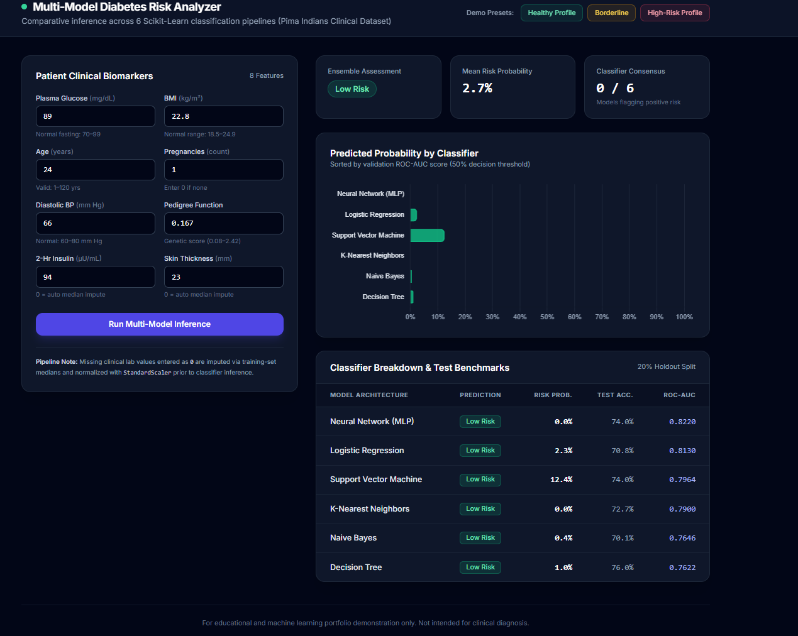

# Multi-Model Diabetes Risk Analyzer

An interactive clinical risk assessment dashboard built with **Flask**, **Scikit-Learn**, **Pydantic**, and **Tailwind CSS**. Refactored from an earlier college classification script into a modular web application that evaluates patient biomarkers across six machine learning pipelines simultaneously.



## Key Engineering Upgrades
- **Leakage-Free Preprocessing Pipelines:** Replaced standalone serialized estimators with end-to-end `sklearn.pipeline.Pipeline` artifacts combining `ColumnTransformer` (median imputation for missing zero-encoded clinical measurements) and `StandardScaler`.
- **Multi-Model Consensus Engine:** Runs concurrent inference across six distinct classifier architectures and aggregates individual probabilities into an ensemble risk tier (`Low Risk`, `Moderate Risk`, `High Risk`).
- **Schema-Validated REST API:** Exposes a `/api/predict` JSON endpoint protected by **Pydantic** physiological range validation to prevent invalid inputs from triggering server errors.
- **Zero-Reload Interactive UI:** Uses asynchronous `fetch()` requests, one-click clinical demo presets, and **Chart.js** visualizations without page reloads.

## Model Validation Benchmarks

Evaluated on a stratified 20% holdout split of the Pima Indians Diabetes Dataset (768 records, 8 clinical features), sorted by ROC-AUC:

| Model Architecture | Test Accuracy | ROC-AUC |
| :--- | :---: | :---: |
| **Neural Network (MLP)** | 74.0% | **0.8220** |
| **Logistic Regression** | 70.8% | **0.8130** |
| **Support Vector Machine (RBF)** | 74.0% | **0.7964** |
| **K-Nearest Neighbors** | 72.7% | **0.7900** |
| **Naive Bayes (Gaussian)** | 70.1% | **0.7646** |
| **Decision Tree** | 76.0% | **0.7622** |

## Project Structure

```text
diabetes-risk-dashboard/
├── app.py                  # Flask application & /api/predict REST endpoint
├── predictor.py            # Pydantic input schemas & multi-pipeline inference engine
├── train_models.py         # Dataset loader, preprocessing pipeline builder & evaluator
├── data/
│   └── diabetes.csv        # Pima Indians Diabetes dataset
├── models/                 # Serialized .joblib pipelines & metrics.json
├── static/
│   └── app.js              # Async API client, preset handlers & Chart.js rendering
├── templates/
│   └── index.html          # Responsive Tailwind CSS dashboard
└── requirements.txt
```

## Local Setup

1. **Clone the repository and create a virtual environment:**
   ```bash
   git clone [https://github.com/](https://github.com/)<your-username>/diabetes-risk-dashboard.git
   cd diabetes-risk-dashboard
   python -m venv .venv
   ```

2. **Activate the environment and install dependencies:**
   - **Windows (PowerShell):**
     ```powershell
     .venv\Scripts\Activate.ps1
     pip install -r requirements.txt
     ```
   - **macOS / Linux:**
     ```bash
     source .venv/bin/activate
     pip install -r requirements.txt
     ```

3. **(Optional) Retrain models from scratch:**
   ```bash
   python train_models.py
   ```

4. **Launch the dashboard:**
   ```bash
   python app.py
   ```
   Open `http://127.0.0.1:5000` in your browser.

---
*Disclaimer: Built for machine learning engineering demonstration purposes only. Not intended for medical diagnosis.*